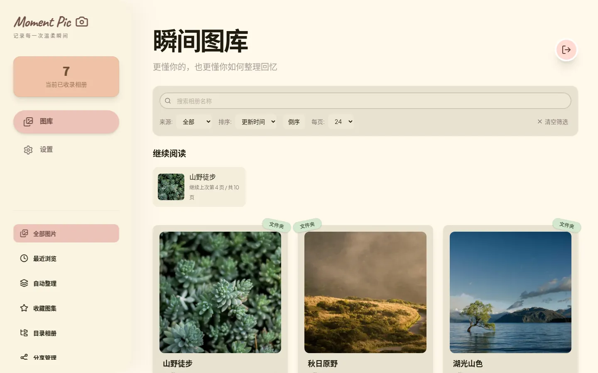
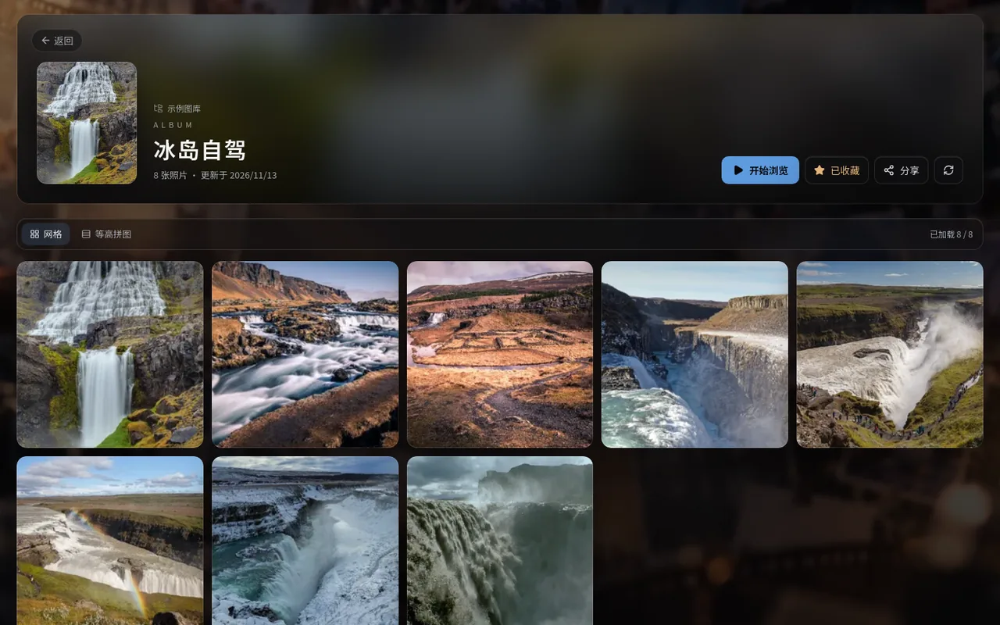
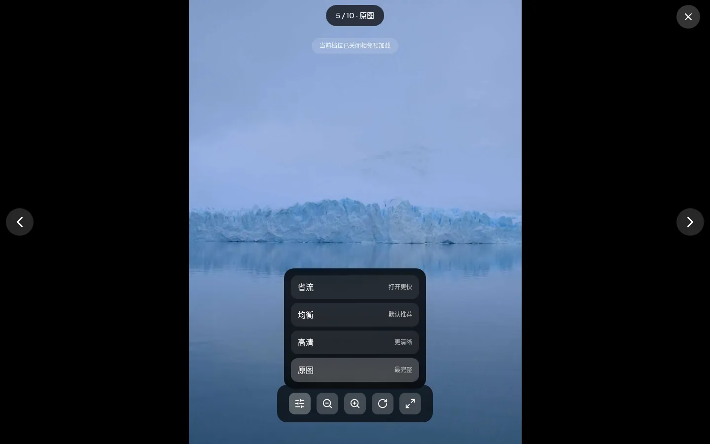
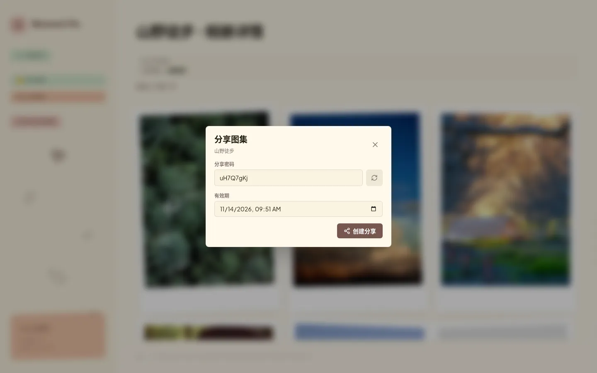
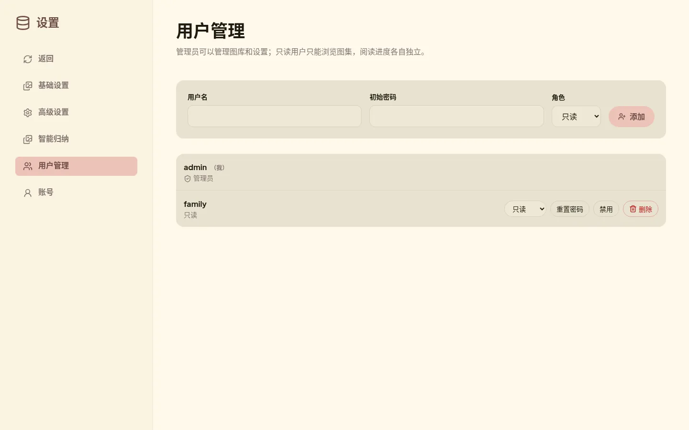
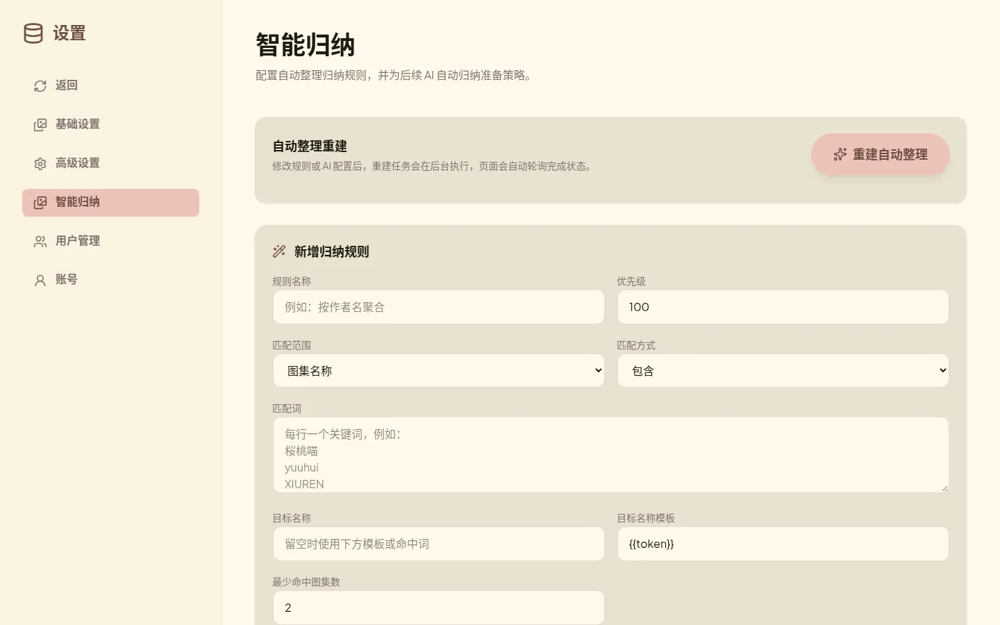
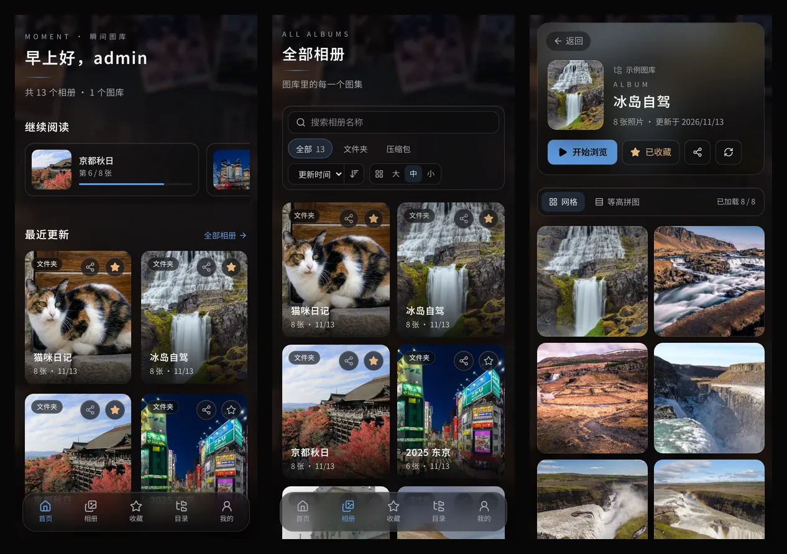

# Moment Pic

[](https://nodejs.org/)
[](https://react.dev/)
[](https://fastify.dev/)
[](https://hub.docker.com/r/joshualoooooo/moment-pic)
[](LICENSE)

轻量级、可自托管的本地图片库。把 NAS / 硬盘上的图片目录和压缩包（ZIP / CBZ / RAR / CBR / 7z）变成能在手机和电脑上浏览的相册：自动生成缩略图、记住每个人的阅读进度、按规则或 AI 自动归纳系列图集，还能生成带密码和有效期的分享链接。

> 面向本地 / 内网私有部署。需要外网访问时，请放在 HTTPS 反向代理之后，并设置 `TRUSTED_PROXIES`。



## 目录

- [功能](#功能)
- [截图](#截图)
- [部署](#部署)
  - [Docker Compose（推荐）](#docker-compose推荐)
  - [群晖 / 绿联等 NAS](#群晖--绿联等-nas)
  - [从源码构建镜像](#从源码构建镜像)
  - [反向代理与外网访问](#反向代理与外网访问)
  - [首次使用](#首次使用)
- [配置](#配置)
- [升级与备份](#升级与备份)
- [常见问题](#常见问题)
- [本地开发](#本地开发)
- [项目结构](#项目结构)
- [许可证](#许可证)

## 功能

**图库与扫描**

- 支持两种图集：图片文件夹，以及 ZIP / CBZ / RAR / CBR / 7z 压缩包（不解压到磁盘，按需读取）
- 可添加多个图库目录；首次全量扫描，之后监听目录变化并增量重扫，也可对单个图集手动重扫
- 支持的图片格式：jpg、jpeg、png、webp、gif、bmp
- 缩略图后台预热，缓存有容量上限，超出后按最旧优先自动回收

**浏览**

- 首页按来源（文件夹 / 压缩包）筛选，按名称、更新时间、图片数量排序，按名称全文搜索
- 「继续阅读」：每个用户各自记录看到第几张，下次打开直接跳回
- 最近浏览、收藏图集、目录相册（按图库目录逐层进入）
- 大图查看器：缩放、旋转、全屏、键盘 ← → 切换、滚轮缩放，手机上左右滑动翻页
- 四档画质（省流 / 均衡 / 高清 / 原图），可设默认档位，查看时随时切换；可设置前后预加载张数
- 适配手机：独立的移动端布局、底部操作栏、手势翻页

**自动整理（智能归纳）**

- 规则归纳：按图集名称、完整路径、父目录或文件名匹配（包含 / 完全等于 / 前缀 / 后缀 / 正则），把同系列图集合并成一个「自动整理」相册，支持名称模板、优先级和最少命中数
- AI 归纳：接入任意 OpenAI 兼容接口，支持「辅助建议 / 低风险自动应用 / 全自动」三种模式和置信度阈值
- AI Token 加密保存在数据库中，也可以用环境变量 `AI_API_TOKEN` 提供

**分享**

- 为单个图集生成分享链接，带访问密码和有效期，对方无需账号即可查看
- 「分享管理」集中查看和撤销仍在有效期内的分享

**账号与权限**

- 多用户，两种角色：管理员可以管理图库、扫描和设置；只读用户只能浏览，看不到收藏、分享、扫描和设置入口
- 管理员可添加、禁用、删除用户、重置密码；每个人可在「设置 → 账号」改自己的用户名和密码
- 服务端会话：登出、改密码、禁用用户立即生效；登录失败限流

**安全与运维**

- 默认安全响应头（CSP、nosniff、禁止页面嵌套、no-referrer）
- 数据库结构版本化迁移，失败自动回滚并拒绝启动
- 内置健康检查 `/api/v1/health`，Docker 镜像自带 `HEALTHCHECK`
- 多架构镜像（amd64 / arm64）

## 截图

截图使用示例图片拍摄。

| 登录 | 图集详情 |
| :---: | :---: |
|  |  |
| **大图查看器与画质切换** | **分享图集** |
|  |  |
| **用户管理** | **智能归纳设置** |
|  |  |

**手机端**



## 部署

镜像发布在 Docker Hub：`joshualoooooo/moment-pic`。

| 标签 | 说明 |
| :--- | :--- |
| `latest` / `main` | main 分支最新版本 |
| `sha-<提交>` | 某次提交的固定版本，生产环境建议固定到这种标签，升级时手动改 |
| `<版本号>` | 打 `v*` tag 时发布 |

同一个标签同时包含 amd64 和 arm64，Docker 会自动拉取匹配的架构。

### Docker Compose（推荐）

新建一个目录，例如 `/opt/moment-pic`，放入 `docker-compose.yaml`：

```yaml
services:
  moment-pic:
    image: joshualoooooo/moment-pic:latest
    container_name: moment-pic
    init: true
    ports:
      - "3210:3210"
    environment:
      ADMIN_PASSWORD: "换成你的强密码"     # 首次启动创建 admin 用
      TZ: Asia/Shanghai
    volumes:
      - ./config:/data                      # 数据库与缩略图缓存
      - /path/to/photos:/photos:ro          # 你的图片目录，只读挂载即可，可挂多个
    restart: unless-stopped
```

```bash
mkdir -p config && sudo chown -R 1000:1000 config   # 容器默认以 uid 1000 运行
docker compose up -d
docker compose ps                                   # 等待状态变成 healthy
```

浏览器打开 `http://<服务器IP>:3210`，然后按[首次使用](#首次使用)添加图库目录。

> `./config` 必须在本地文件系统上（ext4 / btrfs 等）。SQLite 不支持放在 NFS / SMB 网络共享上。

### 群晖 / 绿联等 NAS

和上面一样使用 Compose，在 NAS 的 Docker / Container Manager 里新建项目并粘贴配置即可。几个常见差异：

- **媒体目录权限**：如果图片所在的父目录对普通用户不可遍历（例如权限为 000 的共享文件夹根目录），uid 1000 读不到文件。这时可以给服务加 `user: "0:0"` 以 root 运行，并保持图片目录 `:ro` 只读挂载。
- **路径保持一致更省事**：可以把宿主路径原样挂进容器，例如 `/volume1/photos:/volume1/photos:ro`，之后在设置里填同样的路径。
- **配置目录**：例如 `/volume1/docker/moment-pic/config:/data`。

一个 NAS 上的实际示例：

```yaml
services:
  moment-pic:
    image: joshualoooooo/moment-pic:latest
    container_name: moment-pic
    user: "0:0"                         # 媒体父目录不可遍历时才需要
    ports:
      - "3210:3210"
    environment:
      ADMIN_PASSWORD: "换成你的强密码"
      TRUSTED_PROXIES: 192.168.1.10     # 反向代理所在 IP，没有就删掉
      WS_ALLOWED_ORIGINS: https://photos.example.com
    volumes:
      - /volume1/photos:/volume1/photos:ro
      - /volume2/comics:/volume2/comics:ro
      - /volume1/docker/moment-pic/config:/data
    restart: always
```

### 从源码构建镜像

```bash
git clone https://github.com/JoshuaBarrett2117/moment-pic.git
cd moment-pic
cp .env.example .env        # 填写 ADMIN_PASSWORD，按需填写 LIBRARY_HOST_PATH
docker compose up -d --build
```

仓库自带的 `docker-compose.yml` 使用命名卷 `gallery-data` 保存数据，并把 `LIBRARY_HOST_PATH`（默认是示例图库）挂载到容器的 `/data/library`。

国内网络构建较慢时，可以传入 apt 镜像：

```bash
docker build --build-arg APT_MIRROR=https://mirrors.tuna.tsinghua.edu.cn/debian -t moment-pic:local .
```

### 反向代理与外网访问

Moment Pic 使用 Cookie 会话和 WebSocket（扫描进度推送），反代时需要转发 WebSocket。Nginx 示例：

```nginx
server {
    listen 443 ssl;
    server_name photos.example.com;
    client_max_body_size 20m;

    location / {
        proxy_pass http://127.0.0.1:3210;
        proxy_http_version 1.1;
        proxy_set_header Upgrade $http_upgrade;
        proxy_set_header Connection "upgrade";
        proxy_set_header Host $host;
        proxy_set_header X-Forwarded-For $proxy_add_x_forwarded_for;
        proxy_set_header X-Forwarded-Proto $scheme;
    }
}
```

同时在容器环境变量里设置：

- `TRUSTED_PROXIES`：反代的 IP 或网段。只有这些来源的 `X-Forwarded-*` 头会被信任，用于识别真实客户端 IP（登录限流）和 HTTPS。不要填 `0.0.0.0/0`。
- `WS_ALLOWED_ORIGINS`：网页访问地址，如 `https://photos.example.com`，多个用逗号分隔，不带路径。

Lucky、Caddy、群晖自带反代同理：开启 WebSocket 支持，并把反代的 IP 填进 `TRUSTED_PROXIES`。

### 首次使用

1. 用 `admin` 和 `ADMIN_PASSWORD` 登录。
2. 打开「设置 → 基础设置 → 添加库目录」，填写**容器内**的图片路径（例如上面挂载的 `/photos` 或 `/volume1/photos`），点「添加目录」。可以添加多个。
3. 点「扫描全部」，首页会陆续出现图集，缩略图在后台生成。
4. 建议到「设置 → 账号」改成你自己的用户名和密码；需要给家人看时，在「设置 → 用户管理」添加只读用户。

数据库里已有用户后，`ADMIN_PASSWORD` 不再生效，以页面上设置的密码为准。

## 配置

| 变量 | 默认值 | 说明 |
| :--- | :--- | :--- |
| `ADMIN_PASSWORD` | — | 首次启动（数据库中还没有用户）时必填，用来创建 `admin` |
| `ADMIN_PASSWORD_RESET` | — | 设为 `true` 重启一次，会用 `ADMIN_PASSWORD` 重置第一个管理员的密码。忘记密码时用，用完删掉 |
| `PORT` / `HOST` | `3210` / `0.0.0.0` | 监听端口与地址 |
| `SQLITE_PATH` | `/data/gallery.sqlite` | 数据库文件 |
| `CACHE_DIR` | `/data/cache` | 缩略图缓存目录 |
| `CACHE_MAX_BYTES` | `5368709120` | 缓存容量上限（5 GiB），超出后按最旧优先回收 |
| `CACHE_GC_MIN_AGE_HOURS` | `24` | 缓存文件的最短保留时间 |
| `CACHE_GC_INTERVAL_HOURS` | `6` | 定时清理间隔，设为 `0` 关闭定时清理 |
| `TRUSTED_PROXIES` | 空 | 反向代理 IP / CIDR，逗号分隔 |
| `WS_ALLOWED_ORIGINS` | 空 | 跨源访问时允许的网页 origin，逗号分隔 |
| `AI_API_TOKEN` | 空 | 智能归纳的 AI Token，优先于页面中保存的值 |
| `LOG_LEVEL` | `info` | `trace` / `debug` / `info` / `warn` / `error` / `fatal` |
| `LIBRARY_ROOTS` | `/data/library` | 预留。当前版本图库目录以「设置」里添加的为准，不会根据此变量自动登记 |

旧变量 `LIBRARY_ROOT_PATH` 已废弃，启动时会提示改用新变量。

## 升级与备份

**升级**

```bash
docker compose pull          # 使用固定 sha 标签时，先改 compose 里的 image
docker compose up -d
```

数据库结构在启动时自动迁移。迁移失败会整体回滚并拒绝启动，不会留下半升级状态。每个版本的变化和注意事项见 [CHANGELOG.md](CHANGELOG.md)。

从 0.1.x 升级到 0.2.0：首次启动会用 `ADMIN_PASSWORD` 创建 `admin` 账号，旧的登录 Cookie 失效，所有设备需要重新登录一次；原有阅读进度归属第一个管理员。

**备份**

需要备份的只有配置目录里的数据库（缓存可以重新生成）：

```bash
docker compose stop
cp config/gallery.sqlite* /path/to/backup/
docker compose start
```

**回滚**：把 `image` 改回旧标签，并恢复升级前备份的数据库。新版本迁移过的数据库不能被旧版本直接读取。

## 常见问题

**扫描后首页是空的？**
确认已在「设置 → 基础设置」添加了库目录，且填写的是容器内路径。用 `docker exec moment-pic ls <路径>` 检查容器能否读到文件。

**缩略图大量失败或看不到图片？**
多半是权限问题：容器以 uid 1000 运行，读不到媒体目录。给媒体目录加读权限，或参考上文改用 `user: "0:0"`。

**忘记密码？**
在环境变量里设置新的 `ADMIN_PASSWORD` 和 `ADMIN_PASSWORD_RESET=true`，重启一次后删掉 `ADMIN_PASSWORD_RESET`。

**外网访问时扫描进度不更新？**
反代没有转发 WebSocket，或 `WS_ALLOWED_ORIGINS` 没有包含访问域名。

**数据库报 `database is locked` 或损坏？**
配置目录不能放在 NFS / SMB 上，请改用本地磁盘。

## 本地开发

需要 Node.js 22。

```bash
npm ci
cp .env.example apps/server/.env          # 开发模式后端使用 3211 端口
npm run dev:server                        # 后端 http://localhost:3211
npm run dev --workspace @moment-pic/web   # 前端 http://localhost:3210，/api 与 /ws 代理到 3211
```

常用命令：

```bash
npm test             # 服务端 + 前端测试、ESLint、类型检查、构建
npm run typecheck
npm run lint:web
```

测试会自动创建临时 SQLite 和缓存目录，不读取 `.env` 和真实图库。

CI（GitHub Actions）：PR 会跑依赖审计、全部测试，并验证 amd64 镜像能构建；合并到 main 后分别在 amd64 / arm64 上原生构建，合成多架构镜像推送到 Docker Hub。

## 项目结构

```
apps/
  server/                Fastify 5 + better-sqlite3 + sharp
    src/routes           API 路由
    src/services         业务逻辑：扫描、缩略图、压缩包读取、智能归纳、认证
    src/repositories     SQLite 数据访问
    src/db/migrations    版本化数据库迁移（PRAGMA user_version）
  web/                   React 19 + Vite + Tailwind CSS 4
docs/                    设计文档与截图；docs/archive 为历史验收记录
scripts/                 测试发现与运行脚本
```

第三方客户端接入可参考 [Android 客户端 API 兼容说明](docs/android-client-api-compatibility.md)。

## 许可证

[MIT](LICENSE)
