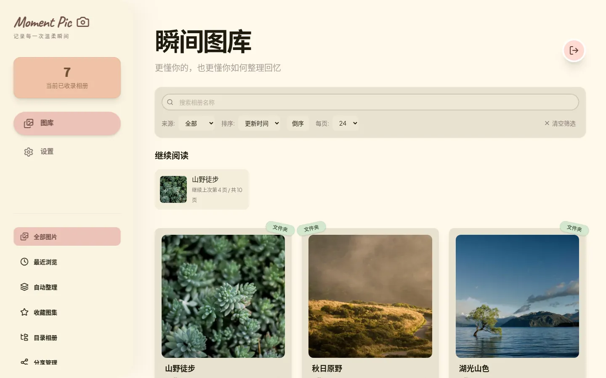
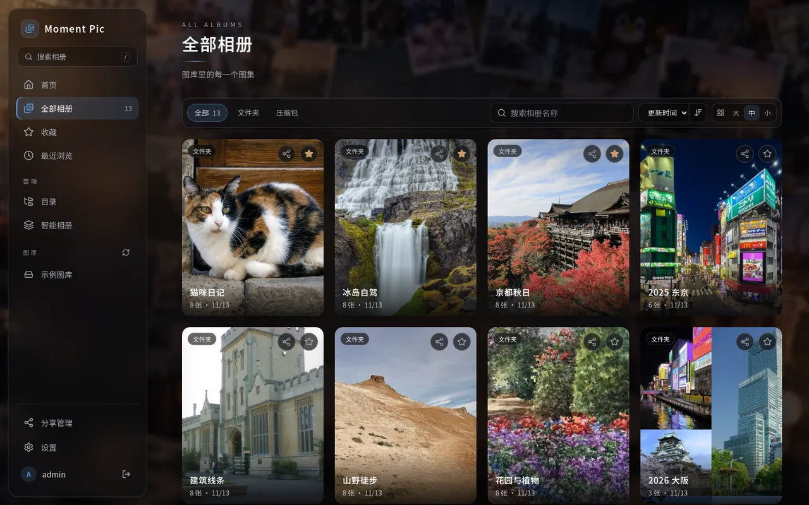
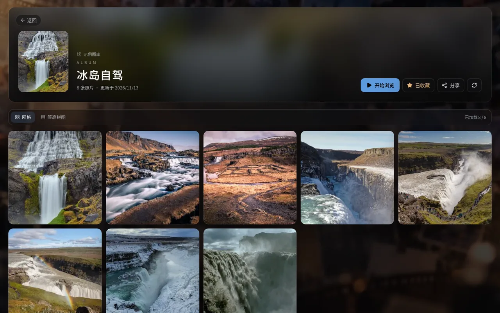
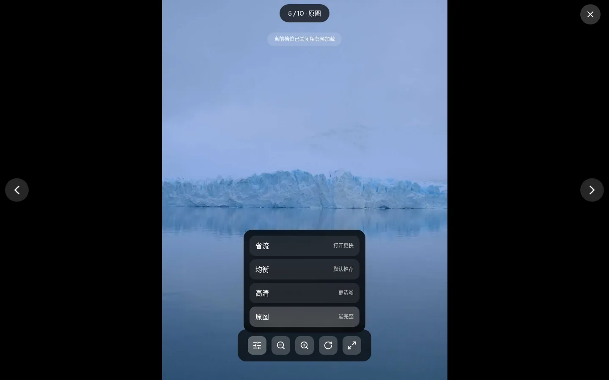
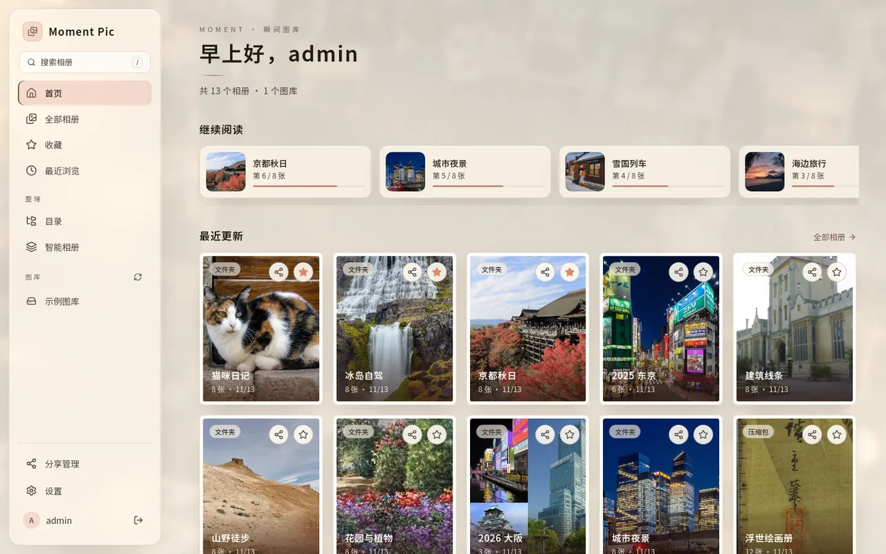
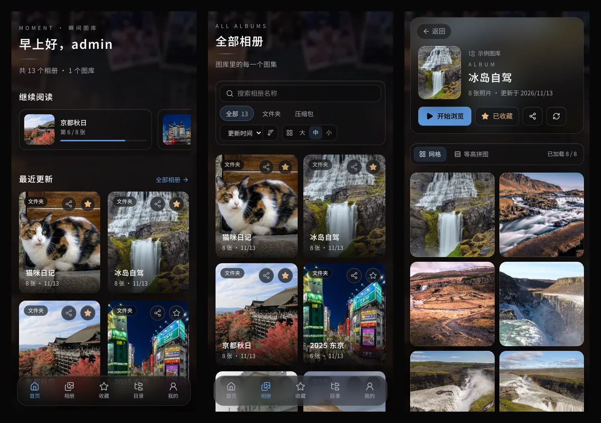

# Moment Pic

轻量级、可自托管的本地图片库。把 NAS / 硬盘上的图片目录和压缩包（ZIP / CBZ / RAR / CBR / 7z）变成能在手机和电脑上浏览的相册：自动生成缩略图、记住每个人的阅读进度、按规则或 AI 自动归纳系列图集，还能生成带密码和有效期的分享链接。界面提供「暗夜玻璃」和「玫瑰纸感」两套主题，背景可以用默认照片墙或你自己的图片。

- 源码与完整文档：<https://github.com/JoshuaBarrett2117/moment-pic>
- 更新日志：<https://github.com/JoshuaBarrett2117/moment-pic/blob/main/CHANGELOG.md>
- 问题反馈：<https://github.com/JoshuaBarrett2117/moment-pic/issues>

> 面向本地 / 内网私有部署。需要外网访问时，请放在 HTTPS 反向代理之后，并设置 `TRUSTED_PROXIES`。



## 主要功能

- 图片文件夹与 ZIP / CBZ / RAR / CBR / 7z 压缩包（不解压到磁盘），多图库目录，目录变化自动增量扫描
- 首页「继续阅读」、最近更新、收藏、目录浏览，列表无限滚动
- 大图查看器：缩放、旋转、全屏、键盘与手势翻页，四档画质（省流 / 均衡 / 高清 / 原图）
- 智能相册：按规则或接入 OpenAI 兼容接口自动归纳系列图集
- 带密码和有效期的分享链接，访客无需账号
- 多用户（管理员 / 只读），每人独立的阅读进度
- 两套主题、自定义背景图；手机端底部标签栏
- 安全响应头、服务端会话、登录限流；内置健康检查

## 镜像标签

| 标签 | 说明 |
| :--- | :--- |
| `latest` / `main` | main 分支最新版本 |
| `sha-<提交>` | 某次提交的固定版本，生产环境建议固定到这种标签，升级时手动改 |
| `<版本号>` | 打 `v*` tag 时发布 |

同一个标签同时包含 amd64 和 arm64，Docker 会自动拉取匹配的架构。

## 快速开始

新建一个目录，例如 `/opt/moment-pic`，放入 `docker-compose.yaml`：

```yaml
services:
  moment-pic:
    image: joshualoooooo/moment-pic:latest
    container_name: moment-pic
    init: true
    ports:
      - "3210:3210"
    environment:
      ADMIN_PASSWORD: "换成你的强密码"     # 首次启动创建 admin 用
      TZ: Asia/Shanghai
      LIBRARY_ROOTS: /photos                # 启动时自动登记为图库目录，多个用逗号分隔
    volumes:
      - ./config:/data                      # 数据库、缩略图缓存与背景图
      - /path/to/photos:/photos:ro          # 你的图片目录，只读挂载即可，可挂多个
    restart: unless-stopped
```

```bash
mkdir -p config && sudo chown -R 1000:1000 config   # 容器默认以 uid 1000 运行
docker compose up -d
docker compose ps                                   # 等待状态变成 healthy
```

浏览器打开 `http://<服务器IP>:3210`。首次启动会自动登记 `LIBRARY_ROOTS` 里的目录并完成第一次扫描。

> `./config` 必须在本地文件系统上（ext4 / btrfs 等）。SQLite 不支持放在 NFS / SMB 网络共享上。

### 首次使用

1. 用 `admin` 和 `ADMIN_PASSWORD` 登录。
2. 设置了 `LIBRARY_ROOTS` 时，目录已自动登记并开始首次扫描，首页会陆续出现图集，缩略图在后台生成。也可以在「设置 → 图库与浏览 → 添加库目录」手动添加，填写**容器内**路径，然后点「扫描全部」。
3. 想隐藏某个 `LIBRARY_ROOTS` 里的目录，请在设置里「禁用」而不是删除：删除后只要它还在环境变量里，下次重启会重新登记。
4. 建议到「设置 → 账号」改成你自己的用户名和密码；需要给家人看时，在「设置 → 用户管理」添加只读用户。
5. 在「设置 → 外观」切换主题和背景。主题与背景模式保存在当前浏览器；上传的背景图保存在服务器上，跟着账号走。

数据库里已有用户后，`ADMIN_PASSWORD` 不再生效，以页面上设置的密码为准。


## 数据卷

| 容器路径 | 用途 |
| :--- | :--- |
| `/data` | 配置目录：数据库 `gallery.sqlite`、缩略图缓存 `cache/`、用户上传的背景图 `backgrounds/`。必须在本地文件系统上 |
| 你的图片目录 | 只读挂载即可，可挂多个，并写进 `LIBRARY_ROOTS` |

容器默认以 uid 1000 运行，端口 `3210`，镜像自带 `HEALTHCHECK`（`/api/v1/health`）。

## 环境变量

| 变量 | 默认值 | 说明 |
| :--- | :--- | :--- |
| `ADMIN_PASSWORD` | — | 首次启动（数据库中还没有用户）时必填，用来创建 `admin` |
| `ADMIN_PASSWORD_RESET` | — | 设为 `true` 重启一次，会用 `ADMIN_PASSWORD` 重置第一个管理员的密码。忘记密码时用，用完删掉 |
| `PORT` / `HOST` | `3210` / `0.0.0.0` | 监听端口与地址 |
| `SQLITE_PATH` | `/data/gallery.sqlite` | 数据库文件。用户上传的背景图存放在同级的 `backgrounds/` 目录 |
| `CACHE_DIR` | `/data/cache` | 缩略图缓存目录 |
| `CACHE_MAX_BYTES` | `5368709120` | 缓存容量上限（5 GiB），超出后按最旧优先回收 |
| `CACHE_GC_MIN_AGE_HOURS` | `24` | 缓存文件的最短保留时间 |
| `CACHE_GC_INTERVAL_HOURS` | `6` | 定时清理间隔，设为 `0` 关闭定时清理 |
| `TRUSTED_PROXIES` | 空 | 反向代理 IP / CIDR，逗号分隔 |
| `WS_ALLOWED_ORIGINS` | 空 | 跨源访问时允许的网页 origin，逗号分隔 |
| `AI_API_TOKEN` | 空 | 智能归纳的 AI Token，优先于页面中保存的值 |
| `LOG_LEVEL` | `info` | `trace` / `debug` / `info` / `warn` / `error` / `fatal` |
| `THUMBNAIL_CONCURRENCY` | `min(2, CPU 核数)` | 缩略图/预览同时生成的数量（1–16）；每个任务内 sharp 仍单线程 |
| `ARCHIVE_EXTRACT_CACHE_MAX_BYTES` | `2147483648` | 7z / RAR（含 cbr）整包解压缓存的总上限（2 GiB），位于 `CACHE_DIR/archive-extract`，按最久未用淘汰；单个压缩包解压后不超过此值的 1/4 才缓存，否则仍逐条读取；设为 `0` 关闭。不计入 `CACHE_MAX_BYTES` |
| `LIBRARY_ROOTS` | `/data/library` | 容器内的图库目录，多个用逗号、分号或换行分隔。启动时自动登记其中存在的目录（只新增，不改动已登记或已禁用的目录）；也可以在「设置」里手动添加 |

旧变量 `LIBRARY_ROOT_PATH` 已废弃，启动时会提示改用新变量。

## 群晖 / 绿联等 NAS

和上面一样使用 Compose，在 NAS 的 Docker / Container Manager 里新建项目并粘贴配置即可。几个常见差异：

- **媒体目录权限**：如果图片所在的父目录对普通用户不可遍历（例如权限为 000 的共享文件夹根目录），uid 1000 读不到文件。这时可以给服务加 `user: "0:0"` 以 root 运行，并保持图片目录 `:ro` 只读挂载。
- **路径保持一致更省事**：可以把宿主路径原样挂进容器，例如 `/volume1/photos:/volume1/photos:ro`，`LIBRARY_ROOTS` 也填同样的路径。
- **配置目录**：例如 `/volume1/docker/moment-pic/config:/data`。

一个 NAS 上的实际示例：

```yaml
services:
  moment-pic:
    image: joshualoooooo/moment-pic:latest
    container_name: moment-pic
    user: "0:0"                         # 媒体父目录不可遍历时才需要
    ports:
      - "3210:3210"
    environment:
      ADMIN_PASSWORD: "换成你的强密码"
      TRUSTED_PROXIES: 192.168.1.10     # 反向代理所在 IP，没有就删掉
      WS_ALLOWED_ORIGINS: https://photos.example.com
      LIBRARY_ROOTS: /volume1/photos,/volume2/comics
    volumes:
      - /volume1/photos:/volume1/photos:ro
      - /volume2/comics:/volume2/comics:ro
      - /volume1/docker/moment-pic/config:/data
    restart: always
```

## 反向代理与外网访问

Moment Pic 使用 Cookie 会话和 WebSocket（扫描进度推送），反代时需要转发 WebSocket。Nginx 示例：

```nginx
server {
    listen 443 ssl;
    server_name photos.example.com;
    client_max_body_size 20m;

    location / {
        proxy_pass http://127.0.0.1:3210;
        proxy_http_version 1.1;
        proxy_set_header Upgrade $http_upgrade;
        proxy_set_header Connection "upgrade";
        proxy_set_header Host $host;
        proxy_set_header X-Forwarded-For $proxy_add_x_forwarded_for;
        proxy_set_header X-Forwarded-Proto $scheme;
    }
}
```

同时在容器环境变量里设置：

- `TRUSTED_PROXIES`：反代的 IP 或网段。只有这些来源的 `X-Forwarded-*` 头会被信任，用于识别真实客户端 IP（登录限流）和 HTTPS。不要填 `0.0.0.0/0`。
- `WS_ALLOWED_ORIGINS`：网页访问地址，如 `https://photos.example.com`，多个用逗号分隔，不带路径。

Lucky、Caddy、群晖自带反代同理：开启 WebSocket 支持，并把反代的 IP 填进 `TRUSTED_PROXIES`。

## 升级与备份

**升级**

```bash
docker compose pull          # 使用固定 sha 标签时，先改 compose 里的 image
docker compose up -d
```

数据库结构在启动时自动迁移。迁移失败会整体回滚并拒绝启动，不会留下半升级状态。**升级前请先备份数据库**：迁移后的数据库，旧版本镜像会拒绝启动。每个版本的变化和注意事项见 [CHANGELOG.md](https://github.com/JoshuaBarrett2117/moment-pic/blob/main/CHANGELOG.md)。

当前数据库结构版本为 5（迁移 0005 为游标分页新增了 `albums` 复合索引）。图库很大时，首次启动建索引会稍慢一些。

从 0.1.x 升级到 0.2.0：首次启动会用 `ADMIN_PASSWORD` 创建 `admin` 账号，旧的登录 Cookie 失效，所有设备需要重新登录一次；原有阅读进度归属第一个管理员。

**备份**

需要备份的是配置目录里的数据库和自定义背景图（`cache` 目录可以重新生成）：

```bash
docker compose stop
cp config/gallery.sqlite* /path/to/backup/
cp -r config/backgrounds /path/to/backup/     # 用户上传的背景图，没有上传过可以跳过
docker compose start
```

**回滚**：把 `image` 改回旧标签，并恢复升级前备份的数据库。新版本迁移过的数据库不能被旧版本直接读取（旧版检测到更高的 `user_version` 会拒绝启动）。

## 常见问题

**扫描后首页是空的？**
看启动日志里是否有「LIBRARY_ROOTS 中的目录未登记」的警告，并确认「设置 → 图库与浏览」里的库目录填的是容器内路径。用 `docker exec moment-pic ls <路径>` 检查容器能否读到文件。

**缩略图大量失败或看不到图片？**
多半是权限问题：容器以 uid 1000 运行，读不到媒体目录。给媒体目录加读权限，或参考上文改用 `user: "0:0"`。

**忘记密码？**
在环境变量里设置新的 `ADMIN_PASSWORD` 和 `ADMIN_PASSWORD_RESET=true`，重启一次后删掉 `ADMIN_PASSWORD_RESET`。

**外网访问时扫描进度不更新？**
反代没有转发 WebSocket，或 `WS_ALLOWED_ORIGINS` 没有包含访问域名。

**`docker compose pull` 拉到的 `latest` 是旧版本？**
部分 Docker Hub 镜像加速源会长时间缓存 `latest`。改用固定的 `sha-<提交>` 标签拉取即可，或者直连 Docker Hub。

**数据库报 `database is locked` 或损坏？**
配置目录不能放在 NFS / SMB 上，请改用本地磁盘。

## 截图

| 全部相册 | 相册详情 |
| :---: | :---: |
|  |  |
| **大图查看器** | **玫瑰纸感主题** |
|  |  |



截图使用 Wikimedia Commons 上公开授权的示例图片拍摄。

## 许可证

MIT
